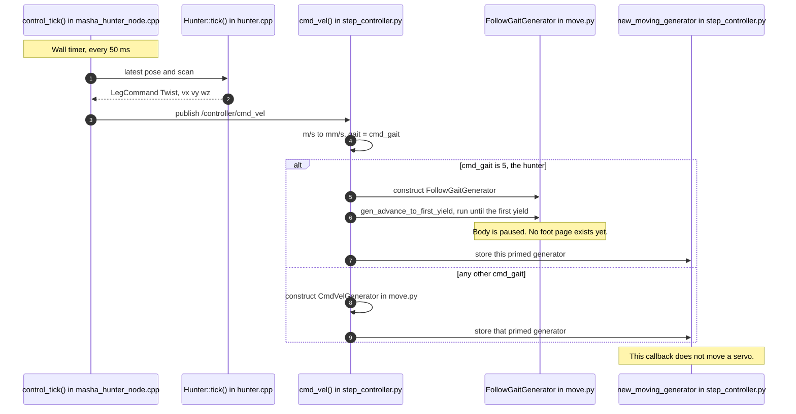
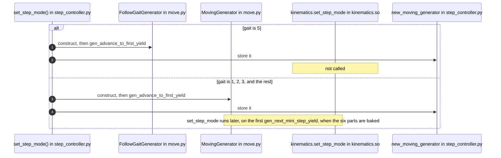
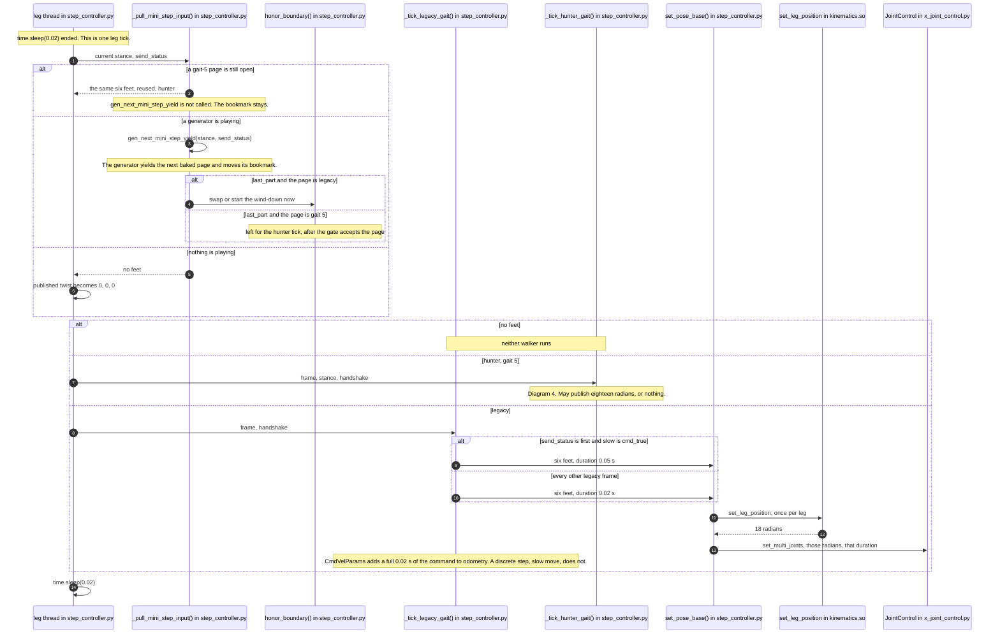
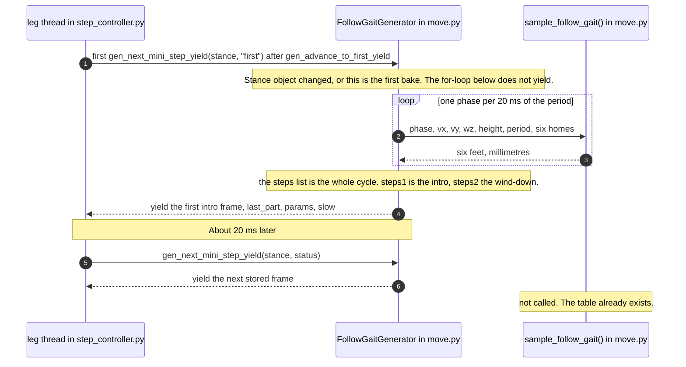
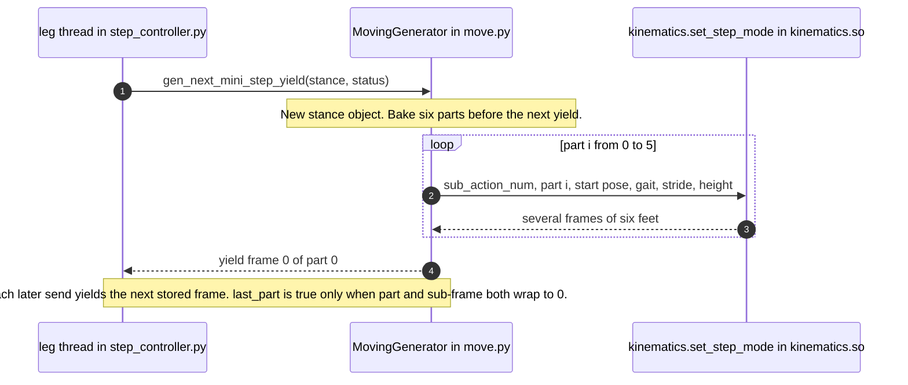
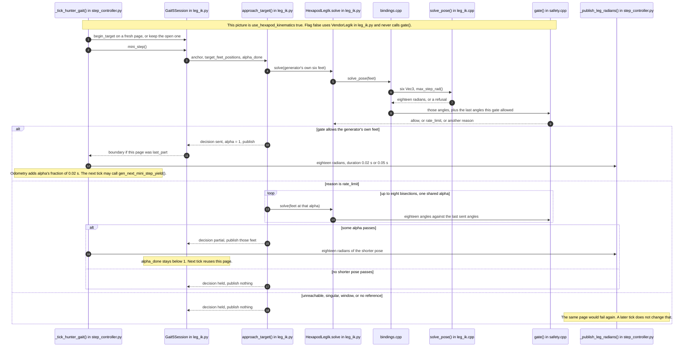
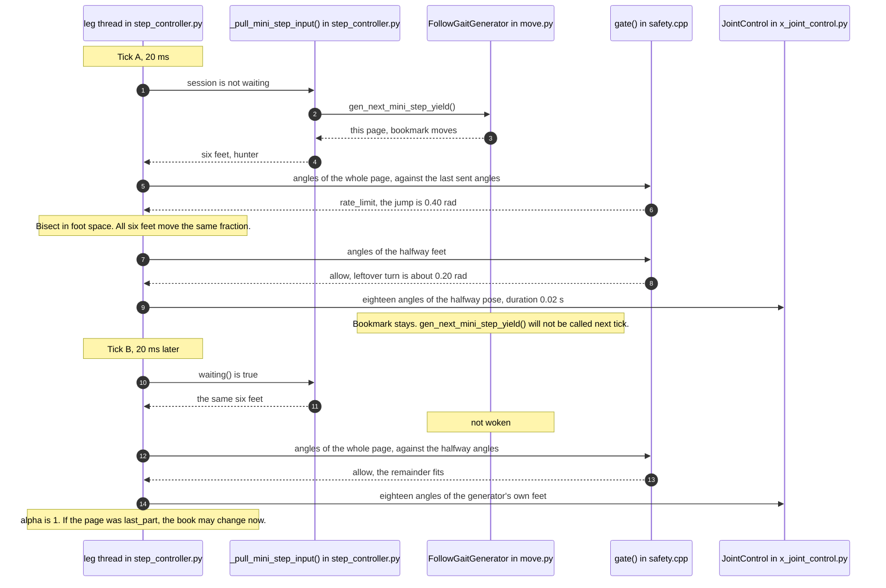
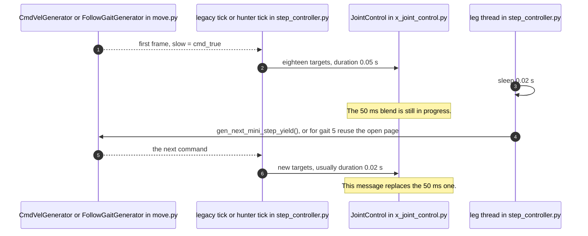

# How a walk moves

Two clocks run at once. The hunter decides a body velocity every
50 ms. The leg thread plays one picture of the six feet every 20 ms.
The pictures are baked in advance, as a film of small frames. The
thread does not invent a new foot curve on each tick. It turns one
page.

This page is the order of those calls. Each actor in a diagram is
named with the file it lives in.

## The two clocks

| Clock | Period | Who starts it | What one tick does |
|---|---|---|---|
| Hunt | 50 ms | `control_timer_` in `proud_up/src/masha_hunter_node.cpp` | Copy sensors, call `tick()` in `proud_up/include/proud_up/hunter.hpp`, maybe publish one `Twist`. |
| Legs | 20 ms | `StepController.loop` in `driver/controller/controller/step_controller.py` | Take one already-baked frame and command the servos. Then `time.sleep(0.02)`. |
| Servo blend | 20 ms, or 50 ms on one splice frame | `JointControl.set_multi_joints` in `driver/kinematics/kinematics/x_joint_control.py` | How long the bus is told to spend reaching this pulse. The leg thread still wakes every 20 ms. |

The 50 ms of the hunt and the 50 ms of a servo blend are different
numbers that happen to match. The hunt clock publishes a velocity.
The blend clock is a duration written into one servo message.

A gait cycle is longer than either clock. The hunter's usual period
is 0.60 s. At 20 ms per frame that film has 30 pages
(`FollowGaitGenerator` in `move.py`: `period * 1000 / 20`).

## The cast

| Actor | File |
|---|---|
| `control_tick()` | `proud_up/src/masha_hunter_node.cpp` |
| `Hunter::tick()` | `proud_up/src/hunter.cpp` (declared in `proud_up/include/proud_up/hunter.hpp`) |
| `cmd_vel()` | `driver/controller/controller/step_controller.py` |
| `set_step_mode()` | same file |
| `loop()` | same file |
| `_pull_mini_step_input()` | same file |
| `_tick_legacy_gait()` | same file |
| `_tick_hunter_gait()` | same file |
| `_WalkHandshake.honor_boundary()` | same file |
| `MovingGenerator` | `driver/controller/controller/move.py` |
| `CmdVelGenerator` | same file |
| `FollowGaitGenerator` | same file |
| `sample_follow_gait()` | same file |
| `Gait5Session` | `driver/controller/controller/leg_ik.py` |
| `approach_target()` | same file |
| `VendorLegIk` | same file |
| `HexapodLegIk` | same file |
| `kinematics.set_step_mode`, `cmd_vel_new_point`, `set_leg_position` | closed `kinematics.so`, called from `move.py` and `leg_ik.py` |
| `solve_pose()` | `hexapod_kinematics/src/leg_ik.cpp`, reached through `src/bindings.cpp` |
| `gate()` | `hexapod_kinematics/src/safety.cpp`, same binding |
| `JointControl.set_multi_joints` | `driver/kinematics/kinematics/x_joint_control.py` |

## 1. A 50 ms hunt tick only queues a film

`control_tick` does not choose foot positions. It publishes a
`Twist`. `cmd_vel()` builds a generator, primes it, and leaves it
in `new_moving_generator`. The feet stay where they are until the
20 ms loop reaches a step boundary and starts that film.

`SelectGait15` is a different message, sent once before the first
`Twist` of a bout. `set_step_mode(15)` stores `cmd_gait = 5`. Later
`Twist` messages then build `FollowGaitGenerator` instead of
`CmdVelGenerator`.



A joystick walk never enters that picture. `set_step_mode()` builds
the film directly. Gait 5 is still `FollowGaitGenerator`. Every
other gait is `MovingGenerator`, and that path is the one that
calls `kinematics.set_step_mode`.



A newer `Twist` every 50 ms replaces the object sitting in the
queue. The film already playing keeps its pages. The swap waits
for `last_part`.

## 2. One 20 ms tick chooses one walker

`loop()` wakes, takes one page, then calls exactly one of the two
ticks. Legacy is `MovingGenerator` and `CmdVelGenerator`. Hunter
is gait 5, `FollowGaitGenerator`.



Legacy `last_part` is handled inside the pull, before the servos
of this page are commanded. The page still plays. The next book
is what starts on a later tick.

Gait 5 stores `last_part` on `Gait5Session` and acts on it only
when `approach_target` has accepted the generator's own feet
(`alpha` 1). A half-played page does not change books.

## 3. Where the targets come from

The generator builds the whole gait step in one burst, then yields
one target per `gen_next_mini_step_yield()`. The 20 ms loop plays one mini-step. A
normal mini-step does not recompute the curves.

### Hunter gait 5

For period 0.60 s the bake writes 30 targets. Target `i` is the six
feet at phase `i / 30 * 2π`. `sample_follow_gait` places each toe
on its stance line or on its swing arch. No closed solver runs
during the bake.



### Legacy films

`CmdVelGenerator` uses the same intro / running / wind-down cut.
The pages come from `kinematics.cmd_vel_new_point` in the closed
library, one call per phase, during the bake.

`MovingGenerator` is the discrete step. One step is 6 parts. Each
part is `period / 6 / 0.02` servo frames, at least one. A 1.00 s
step is 9 frames per part, 54 yields. Each part is one call to
`kinematics.set_step_mode`. The yield tag is `slow = "move"`, so
the legacy tick always uses the 20 ms blend, and a wrapped step
swaps at once.



## 4. The hunter tick and the gate

`_tick_hunter_gait` always goes through `Gait5Session` and
`approach_target`. The flag `use_hexapod_kinematics` chooses who
turns the six feet into angles. It is read once, when that
generator's session is created.

- Flag false, the default. `VendorLegIk` calls
  `kinematics.set_leg_position` six times and always allows the
  page. There is no rate gate, so there is no partial page.
- Flag true. `HexapodLegIk` calls `solve_pose` then `gate`. A page
  that is legal but too fast for one 20 ms tick is shortened.
  Any other refusal publishes nothing.

The gate is one yes or no for all eighteen joints. It lives in
`safety.cpp`. It does not move a foot. `approach_target` is the
repair, and it lives in `leg_ik.py`.

A partial page moves all six feet by the same fraction `alpha`
along the straight line from the start of this page to the
generator's own feet:

```text
feet(alpha) = anchor + alpha * (target_feet_positions - anchor)
```

`alpha` 1 is the page the generator yielded. A smaller `alpha`
is the same page, not finished. All eighteen angles of that
shorter pose are published together.



### Two ticks of one page that was too fast

Suppose the generator's page wants one femur to turn 0.40 rad, and
`max_step_rad()` is about 0.264 rad. The destination feet are
legal. One 20 ms jump is not.



The second tick cures the refusal because the feet already moved.
The remainder is a smaller turn between the same two legal poses.
A page that is unreachable is a hold: nothing is published, and
waking again on those same feet gets the same refusal.

## 5. The other 50 ms, the servo blend

On the first frame after two films are spliced, the new page can
sit more than 7 mm away from the old feet. The generator then
yields `slow = "cmd_true"`. The leg thread still sleeps 20 ms.
The servo message for that one frame asks for a 50 ms blend.
The next wake, 20 ms later, sends a new target and replaces it.

`MovingGenerator` yields `slow = "move"`, so this branch never
runs for a discrete step. Its blend is 20 ms.



## Recap

- The hunt publishes a `Twist` every 50 ms. The leg thread plays one baked frame every 20 ms.
- Legacy pages go through `set_pose_base` and `kinematics.so`. Hunter pages go through `Gait5Session`. The rate gate runs only when `use_hexapod_kinematics` is true.
- A partial hunter tick moves all six feet the same fraction of one page. The next 20 ms tick continues that page. The generator is asked for a new page only after `alpha` reaches 1.
